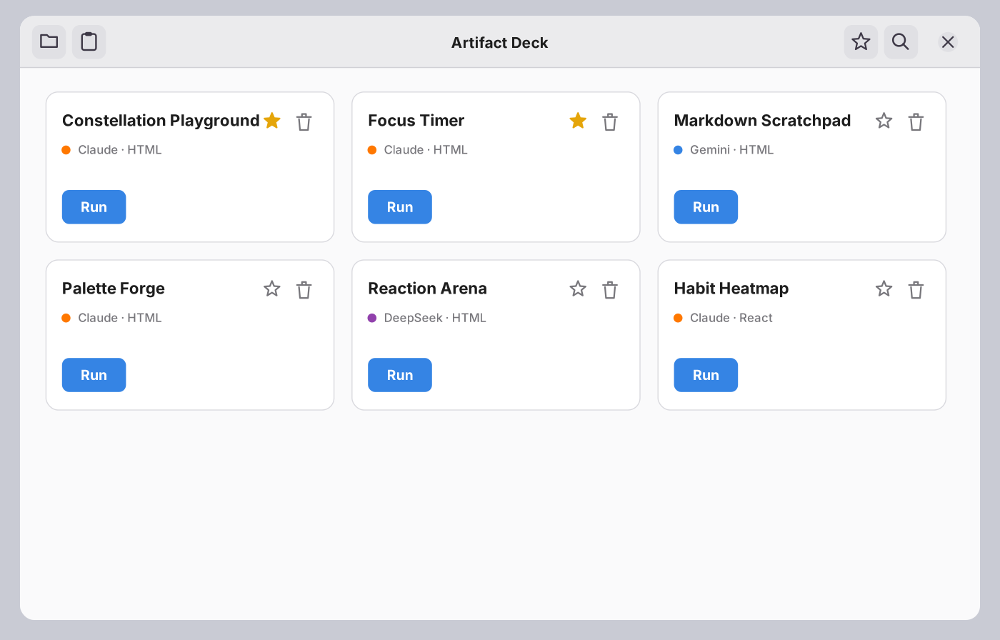
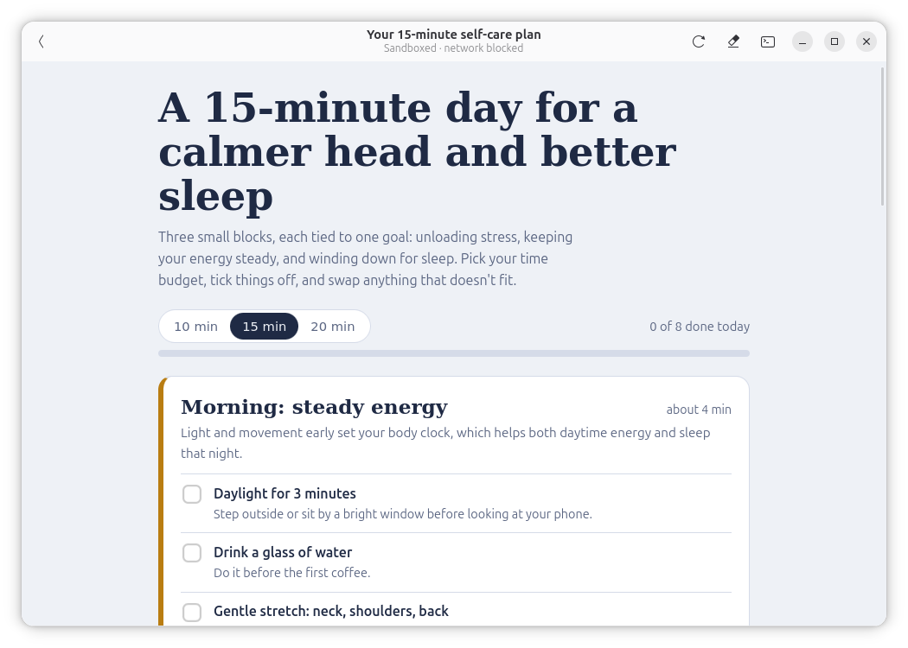

# Artifact Deck

A small desktop app for Ubuntu that keeps all your AI-made artifacts (from Claude, Gemini, DeepSeek and others) in one place and runs them **safely and offline**.

> The screenshots in this folder are illustrative mockups drawn in the Adwaita style, not captures of the running app. Real colors follow your system theme (light or dark).

## What it does

- **One library.** Every artifact is a card showing its name, which AI made it, and its type (HTML, JavaScript or React).
- **One-click run.** Press **Run** and the artifact opens full-size inside the app.
- **Safe by default.** Artifacts cannot reach the internet, open pop-ups, or ask for your camera, microphone or location.
- **Remembers progress.** Scores, trackers and settings an artifact saves are kept between runs, separately for each artifact.
- **Stays offline.** After a one-time library download, React artifacts with charts and icons run without a connection.

## Using it

| I want to... | Do this |
|---|---|
| Add an artifact from a file | Drag the file onto the window, or press the folder button |
| Add an artifact I copied | Press the clipboard button (it reads your clipboard) |
| Run an artifact | Press **Run** on its card |
| Find one | Press the magnifier, or just start typing |
| Mark favorites | Press the star, then use the star in the top bar to show only favorites |
| Delete one | Press the bin. An **Undo** message appears for a few seconds |
| See errors | In the runner, press the terminal button to open the console |
| Start an artifact fresh | In the runner, press the clear button (**Reset saved data**) |

When you add something, a small box asks for a name, who made it, and optional tags. The app detects the type for you.

Supported files: `.html`, `.htm`, `.js`, `.jsx`, `.tsx`, `.txt`, up to 5 MB.

## How the safety works, in plain words

Each artifact runs inside a locked room:

1. **No network.** A strict rule is added to the page so it cannot send or receive anything online.
2. **No wandering.** Links that would leave the page are blocked, and so are new windows.
3. **No permissions.** Requests for camera, microphone, location and similar are refused.
4. **Own storage.** Whatever an artifact saves stays in its own private folder.

This is a strong barrier for ordinary artifacts, but it is not a guarantee against deliberately hostile code. Only run artifacts you got from an AI chat or a source you trust. See `packing.md` for the Flatpak option, which adds another layer.

## What does not work

- **Claude API calls.** Artifacts that talk to Claude (the "AI-powered artifact" kind) cannot work here. The runner shows a banner when an artifact tries.
- **Other online services.** Anything that fetches data from the internet will fail, by design.
- **Unknown React libraries.** Common ones work (recharts, lucide-react, lodash, d3, mathjs, papaparse). Others, such as shadcn components, appear blank and the console says which.
- **Python or Node apps.** Only HTML, JavaScript and React artifacts are supported.
- **Editing code.** There is no editor inside the app, on purpose. To change an artifact, ask the AI for a new version and add it again.

## Where things are stored

Everything lives in `~/.local/share/artifact-deck/`:

- `artifacts/` your artifact files
- `library.json` the list, names and favorites
- `state/` each artifact's saved data
- `vendor/` the downloaded React libraries

Back up or move that folder to take your library with you.

## Files in this folder

| File | Purpose |
|---|---|
| `artifact_deck.py` | The app. This is the file that runs |
| `sandbox.py`, `vendor.py` | Helpers the app needs (keep them next to the app) |
| `install.md` | How to install and fix problems |
| `packing.md` | How to turn it into an installable package |
| `install.sh`, `uninstall.sh`, `make-deb.sh` | Helper scripts |
| `data/` | App icon and menu entry |
| `screenshots/` | Mockups used in this page |
